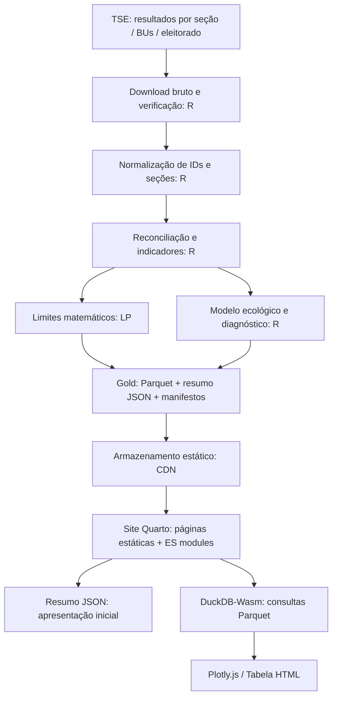

# Caderno Eleitoral — Especificação funcional e técnica

**Versão:** 1.0 · **Objetivo:** referência executável para desenvolver o produto em Claude Code.  
**Documentos complementares:** `visao_inicial.md` (origem), `arquitetura.md` (stack e módulos), `05-metodo-analitico.md` (método), `01-guia-identidade-visual.md`, `03-contratos-de-dados.md`, `04-roteiro-implementacao-claude-code.md`, `../CLAUDE.md`.

## 0. Resumo executivo

Construir um observatório eleitoral estático, em português brasileiro, que permite selecionar um município e comparar o 1º e o 2º turno da eleição presidencial de 2026 em diferentes graus de inferência: (1) fatos/contabilidade exata, (2) limites sob hipóteses explícitas, (3) estimativas ecológicas e diagnósticos. O ETL, a análise e o pré-cálculo ocorrem em R, offline ou em jobs; o site estático carrega resumos e Parquet sob demanda, consulta com DuckDB-Wasm no browser e apresenta visualizações acessíveis. **Sem servidor de aplicação, endpoints próprios, autenticação, banco operacional nem inferência estatística pesada no cliente.**

O produto não identifica como cada eleitor votou, não infere fraude e não apresenta transferências estimadas como fatos individuais. É um projeto independente, com fontes oficiais referenciadas e metodologia aberta.

**Origem e crédito.** A ideia da análise vem da thread de Rômulo Fiúza e Mello (@fiuzaemello), publicada no X em 26 de outubro de 2026: https://x.com/fiuzaemello/status/2114763737425211824. O registro da motivação está em `visao_inicial.md`. O crédito é **requisito do produto**: aparece no rodapé de todas as páginas e na página `Sobre` (ver §3, §4.1 e §4.8). O produto analisa qualquer município do país na eleição presidencial de 2026, com dados oficiais do TSE, e não dá tratamento, fixture ou destaque especial a nenhum município.

### 0.1 Decisões fechadas (MVP)

| Tema | Decisão |
|---|---|
| Escopo eleitoral | Presidente da República 2026: 1º turno (4/10) × 2º turno (25/10), todos os municípios; exterior fora; nenhuma outra eleição é usada (`05-metodo-analitico.md` §0) |
| Idioma e localização | pt-BR; datas BRT ou ISO no metadata; números com `Intl.NumberFormat('pt-BR')` |
| Interface | Site Quarto (`web/`) + JavaScript em ES modules sem etapa de build; CSS com tokens (`web/css/design-tokens.css`); sem biblioteca genérica de dashboards. Mesmo stack do DudesApp (ver `arquitetura.md`, ADR-03) |
| Build/deploy | `quarto render web` gera `web/_site/` estático; hospedagem em Pages/CDN; sem Node no build do site |
| Rota compartilhável | `explorar.html?e=<election_id>&m=<codigo_tse>`; parâmetros validados contra catálogo |
| Catálogo | JSON leve, versionado, carregado no início |
| Primeiro paint municipal | resumo JSON pré-calculado; WASM só no detalhe; sem bloquear título ou indicadores |
| Consulta de detalhe | `@duckdb/duckdb-wasm` lendo Parquet sob demanda |
| Gráficos | Plotly.js para barras, slope, scatter, intervalos e Sankey (trace nativo); tabelas HTML nativas |
| ETL | R + `targets` + `renv` + `duckdb` (motor e escritor de Parquet, sem `arrow`) + `dplyr`/`dm` |
| Modelagem | verificações V1–V3, limites de Fréchet e cenários, estimação com dois ou mais métodos e grau de identificação por célula (`05-metodo-analitico.md`) |
| Estado de dados | nenhum número inferido a partir de placeholders; usar estado `indisponível` quando faltar fonte |
| Design | tokens canônicos de `web/css/design-tokens.css`; aparência editorial sóbria |
| Analytics/privacidade | nenhum rastreamento de usuário como requisito do MVP |

Documentação oficial: https://quarto.org/docs/websites/ ; https://duckdb.org/docs/current/clients/wasm/data_ingestion ; https://docs.ropensci.org/targets/.

## 1. Público, objetivos e limites

### Públicos

- **Público interessado:** consulta resultados e uma explicação honesta do que mudou.
- **Jornalista/pesquisador:** audita os números e exporta tabelas/medidas reproduzíveis.
- **Analista de dados:** inspeciona seções, hipóteses, validação dos dados e versões de modelos.

### Objetivos de usuário

1. Localizar uma cidade sem conhecimento técnico dos códigos eleitorais.
2. Ver o resultado de cada turno, a conta que liga os totais dos dois turnos e as verificações dos dados.
3. Explorar variações em cada zona/seção, com normalizações e tabela verificável.
4. Investigar limites possíveis e, quando metodologicamente habilitado, fluxos ecológicos estimados.
5. Conhecer exatamente a fonte, método, restrições e grau de incerteza de cada resultado.
6. Compartilhar URL do recorte e baixar dados do município.

### Fora de escopo MVP

- Predições de intenção de voto, recomendações de voto, segmentação de eleitores ou inferência individual.
- Detecção automatizada de fraude ou afirmação de irregularidade.
- Painel em tempo real de apuração; o site usa snapshots versionados.
- Acesso a dados pessoais, login, perfil ou comentários públicos.
- Geolocalização individual do eleitor ou mapas de calor que aleguem conhecer preferências individuais.
- WebR e modelagem MCMC executada no navegador.
- Aplicação Shiny, backend REST, GraphQL, Postgres, autenticação ou infraestrutura serverless para a interface.
- Outros cargos e outras eleições, inclusive como base de desenvolvimento ou calibração.
- Comparação entre municípios como requisito de primeira versão; arquitetura preparada para fases seguintes.
- Logs de urna e análise de horários de votação.

## 2. Arquitetura e fluxo de dados

A publicação é um **artefato compilado de dados**: uma versão de release tem conteúdo imutável, hash dos recursos, esquema e metadados. O manifesto `latest.json` aponta para um release validado. Não substituir arquivos existentes de um release.

### Tópicos de separação

- Scripts `R/` nunca importam código do frontend.
- O frontend nunca calcula inferência ecológica, bootstrap nem modelos bayesianos.
- Funções de transformação e formatação de interface não fazem estimação política.
- Transformações no browser se restringem a consultas, ordenação, filtros, percentuais simples e agregação da tabela carregada.
- Cada indicador exibe sua **linhagem** (`dataset`, eleição, turnos, recorte, versão de método, versão de release).

## 3. Roteiro de navegação

A navegação sempre é previsível; evitar sidebar persistente, mega-menu e modal como único modo de navegação.

| Rota estática | Conteúdo | Requisitos |
|---|---|---|
| `index.html` (`index.qmd`) | Home editorial e busca principal | Conteúdo estático, busca acessível |
| `explorar.html` (`explorar.qmd`) | Página municipal | Query `e` e `m` determina recorte; renderização no cliente |
| `metodologia.html` | Explicação dos níveis de evidência e modelos | Texto estático, fórmulas (LaTeX do Quarto) e exemplos verificados |
| `dados-e-codigo.html` | Fontes, método de download, esquemas e link para repositório | Atribuição e política de publicação |
| `sobre.html` | Independência, princípios editoriais e **origem da análise** | Curta, sem autopromoção; crédito à thread de Rômulo Fiúza e Mello com link |

Todas as páginas têm rodapé com o crédito da ideia (ver `01-guia-identidade-visual.md` §5.9), configurado uma única vez em `web/_quarto.yml` (`page-footer`).

Não gerar milhares de páginas durante o build. `explorar.qmd` é uma página única renderizada no cliente; `URLSearchParams` fornece a seleção. Atualizar a URL com `history.pushState`/`popstate` preservando o botão Voltar e o estado compartilhável. Abrir uma URL inválida deve apresentar escolha de município, nunca dados de outra cidade.

### 3.1 Fluxo de seleção

1. Home carrega `catalogo.json` em background, sem inicializar DuckDB-Wasm.
2. Foco na busca por município (mínimo três caracteres para filtro ou pesquisa por UF).
3. Combobox sugere `Município — UF`, ordenado por correspondência textual e sem duplicar homônimos.
4. Usuário escolhe eleição/cargo (MVP com uma eleição padrão disponível no catálogo, configurável).
5. Navegar para `explorar.html?e=2026-presidente&m=<codigo_tse>` (o ID do exemplo deve existir no catálogo real).
6. Validar disponibilidade; buscar `resumo.json`; apresentar título, números, cobertura e alertas.
7. Quando usuário abre `Seções`, `Transferências` etc., lazy-load dos Parquets e do runtime Wasm.
8. Se não houver dados suficientes, preservar resumo e explicar o bloqueio da análise específica.

**Busca:** normalizar Unicode em JavaScript (`NFD`, remover diacríticos, lowercase), tratar espaços e exibir município + UF. Não usar busca geográfica ou endereço do usuário.

## 4. Especificações de telas

### 4.1 Home (`/`)

**Objetivo:** reduzir tempo entre visitar site e escolher município.

Blocos, nesta ordem:

- Cabeçalho com wordmark, `Explorar`, `Metodologia`, `Dados e código`.
- H1 `Entenda os resultados eleitorais do seu município`.
- Texto de apoio em até duas linhas: `Compare turnos, explore seções eleitorais e entenda o que os dados permitem concluir.`
- `MunicipalityCombobox` com sugestões e foco principal; seletor de eleição secundário.
- Linha de confiança: `Projeto independente · Dados públicos do TSE · Métodos e versões disponíveis`.
- `Como ler`: três parágrafos curtos para `Observado`, `Limite matemático`, `Estimado`.
- Rodapé: crédito da ideia (`Análise inspirada na thread de Rômulo Fiúza e Mello`, com link), metodologias, versão dos dados, data da última atualização e licença do projeto.

Sem mapa decorativo, carousel de destaques partidários, hero visual ilustrativo, KPIs nacionais sem contexto ou cards de notícias.

### 4.2 Explorar — cabeçalho contextual

- Breadcrumb `Brasil / UF / Município`.
- H1 `Nome do município, UF`.
- Subtítulo com eleição, cargo, turno e quantidade de seções com dados comparáveis.
- Ações: `Trocar município`, `Compartilhar`, `Baixar dados`.
- Indicador discreto de qualidade: `112 de 115 seções na análise de transição` ou `Cobertura parcial`, com link para `Qualidade`.
- Navegação horizontal por abas: `Resumo`, `Seções`, `Transferências`, `Cenários`, `Qualidade`.

### 4.3 Aba Resumo (MVP obrigatório)

**Perguntas respondidas:** quantos votos cada candidato recebeu em cada turno? Como se explica aritmeticamente a diferença dos totais? Como mudou comparecimento e votos inválidos?

**Componentes:**

- `MetricStrip`: quatro métricas, sempre com unidade: votos do finalista A no 2º, votos do finalista B no 2º, variação de comparecimento, variação de inválidos; a seleção de indicadores pode ser refinada após o MVP.
- `TurnComparisonPlot`: votos de ambos os finalistas no 1º/2º turnos, com legenda direta e tabela de valores.
- `ReconciliationWaterfall`: composição contábil `outros_1 + delta_comparecimento - delta_invalidos = delta_a + delta_b` (quando a eleição tem apenas dois finalistas no segundo turno e seções reconciliadas).
- `EditorialInterpretation`: texto exclusivamente factual, gerado de templates determinísticos e regras; nenhuma API de LLM.
- `MethodsFootnote`: origem dos dados, unidade de análise, cobertura, data e versão.

O waterfall é aritmética dentro de cada turno, não verificação entre turnos (`05-metodo-analitico.md` §2). Unidades com mudança de eleitorado seguem as classes de população de `05` §3 e nunca são forçadas numa matriz fechada.

### 4.4 Aba Seções (MVP obrigatório)

**Perguntas:** em quais seções os votos/comparecimento variaram? Existe associação estatística entre variáveis agregadas?

**Componentes:**

- Filtros por zona, local e opções de normalização (`votos absolutos`, `por 100 aptos`, `pontos percentuais`).
- `SectionScatter`: eixo X `delta_comparecimento` (ou % por aptos), eixo Y `delta_votos_a` ou `delta_votos_b`, com possibilidade de selecionar candidato; referência de zero, N de seções, correlação de Pearson e, se calculado, intervalo.
- Aviso: `A correlação por seção não identifica o comportamento individual dos eleitores.`
- `SectionRanking`: ordenação por crescimento, redução, comparecimento, aptos e cobertura.
- `SectionDataTable`: seção, zona, aptos 1/2, votos finalistas 1/2, outros 1, inválidos 1/2, comparecimento 1/2, deltas e flag de comparabilidade.
- `Download CSV` da seleção visível.

Não marcar seções com rótulo `suspeita` ou `fraude`. Seções agregadas/incompatíveis aparecem separadas ou com flag e não entram silenciosamente na correlação.

### 4.5 Aba Transferências (MVP: limites; modelos probabilísticos progressivos)

**Perguntas:** quais fluxos são matematicamente possíveis? O que o modelo ecológico estima, e qual a incerteza?

**Ordem editorial:**

1. Explicação de uma frase: `Não existem dados individuais sobre como cada pessoa transferiu o voto; os fluxos abaixo dependem de hipóteses explícitas.`
2. Limites e estimativa aparecem na mesma tabela; a estimativa só aparece quando `features.ecological_model` é `ready` ou `partial` (`05-metodo-analitico.md` §5.7).
3. Resumo da hipótese/método e, no caso de estimativa, status de convergência e cobertura.
4. `FlowMatrix`: tabela RxC com linhas de origem e colunas de destino. Cada célula mostra sua classe de identificação (`determinada`, `estimada`, `fraca`, `não identificada`) e, conforme a classe, os limites, a estimativa (média posterior) com intervalo e a faixa entre métodos.
5. `TransferSankey`: **só com `features.ecological_model = ready`** e só com células `determinada`/`estimada`; o restante aparece agregado como "não identificado". Nunca a partir de limites.
6. `UncertaintyTable`: por célula, estimativa, intervalo do modelo e limites de viabilidade em colunas distintas; sempre indicar tipo.
7. Link para `Metodologia` e download com `method_id` e `assumption_id`.

**Gate de qualidade:** as regras de publicação são as de `05-metodo-analitico.md` §5.7. Nunca reescalar estimativas para que pareçam somar os totais; a matriz pontual é sempre a média posterior das contagens.

### 4.6 Aba Cenários (MVP: cenários discretos pré-computados)

**Perguntas:** quanto mudam as conclusões quando altero hipóteses?

- Dropdown `Cenário base`, `Sem troca direta entre finalistas`, `Outros comportamentos plausíveis definidos no método` (somente os scenarios publicados no manifest do município).
- Comparar matrizes ou limites lado a lado, com explicação das restrições.
- Mostrar incompatibilidade de modelo, impossibilidade matemática ou ausência de dados de forma visível.
- O browser **não** calcula novos modelos ou LP para sliders arbitrários no MVP; apenas alterna datasets pré-computados.
- Nunca equiparar cenários narrativos a fatos observados.

### 4.7 Aba Qualidade (MVP obrigatório)

- `Qualidade de dados`: fonte, arquivos e hashes, data de coleta, universo de seções, cobertura do município, reconciliação das somas.
- `Comparabilidade`: tabela de seções excluídas e motivo; mapa entre unidades quando houver agregação/transferência.
- `Qualidade de análise`: nível de prontidão por método; diagnóstico da inferência, amostras/iter, convergência e limites de interpretação.
- `Reproduzibilidade`: versão do código do pipeline, release e link para o método, com botões para downloads.
- Mensagem obrigatória: `Resultados agregados não identificam transferências individuais de voto.`

### 4.8 Metodologia e dados

- Metodologia inclui notação formal, identidades contábeis, diferença entre limites e intervalos, falácia ecológica, restrições utilizadas e exemplos sem alegação de causa.
- Dados e código trazem links oficiais TSE, repositório (quando publicado), changelog de datasets, licença e histórico de releases.
- Usar `FAQ` curto se necessário; sem chat de IA ou resumo opinativo.
- `Sobre` tem a seção **Origem da análise**: a ideia vem da thread de Rômulo Fiúza e Mello (@fiuzaemello), publicada no X em 26/10/2026 (link acima); o Caderno Eleitoral generaliza esse tipo de análise para qualquer município, com metodologia própria; método, código e eventuais erros são de responsabilidade do projeto, não do autor da thread.

## 5. Engenharia de dados em R

### 5.1 Fontes e ingestão

Fonte prioritária: Portal de Dados Abertos TSE (`https://dadosabertos.tse.jus.br/`). Fontes: `votacao_secao_2026_BR.zip` (votos por seção e candidato) e `detalhe_votacao_secao_2026.zip` (aptos, comparecimento, brancos, nulos, situação da seção). Descoberta de recursos por eleição e UF; downloads por lote, com retries, checksum e registro de URL/data/tamanho.

Não depender de arquivo `csv` de formato único entre eleições. Criar schemas por versão de fonte, testes de parser e contrato canônico. O parser de BU deve conferir seus totais com os dados agregados.

### 5.2 Pipeline `targets`

`discover_sources -> fetch -> verify -> parse -> normalize -> harmonize_turns -> validate_counts -> municipal_aggregates -> sections_metrics -> lp_bounds -> ecological_model(optional) -> sensitivity -> diagnostics -> gold_export -> manifest -> publish_check`.

**Paralelização:** primeiramente por eleição/UF, depois grupos de municípios/partições. Não criar 5 mil processos R simultâneos; usar batching de municípios semelhantes e limites de memória. Conservar arquivos bronze e snapshots reproduzíveis. `targets` deve invalidar somente etapas dependentes de novas fontes ou mudanças no código.

### 5.3 Comparação entre seções

Pareamento, verificações V1–V3, tipos de seção (`regular`, `transit`, `special`) e classes de população (`closed`, `net_change`, `excluded_population`): `05-metodo-analitico.md` §1–3. A cobertura publicada é `eligible_share_used`: aptos do 1º turno nas unidades usadas ÷ aptos do município. Toda unidade fora da análise de transição tem `exclusion_reason`.

### 5.4 Contabilidade

- Votos para candidatos, outros, brancos, nulos, comparecimento, abstenção, eleitores aptos por seção e turno.
- Conferir `validos + invalidos = comparecimento` e `comparecimento + abstencao = aptos` conforme definições e cobertura do arquivo.
- A identidade `delta_A + delta_B = outros_1 + delta_comparecimento - delta_invalidos` decorre das contas de cada turno; é exibida como explicação, nunca usada como verificação entre turnos (`05-metodo-analitico.md` §2).
- Todas as soma municipais batem com as somas das seções incluídas; divergências têm registros e bloqueiam publicação de resultado enganoso.

### 5.5 Limites de inferência ecológica

Limites de Fréchet em fórmula fechada por unidade, somados no município, e cenários com restrições por unidade resolvidos por LP: `05-metodo-analitico.md` §4. Os limites de uma célula não implicam a possibilidade de atingir simultaneamente limites extremos de outras células.

**Soluções R:** `ROI` + solver `ROI.plugin.glpk` ou `lpSolve`, escolha documentada e coberta por testes. Publicar conjunto de hipóteses (`assumption_id`) e status `feasible`/`infeasible`.

### 5.6 Modelo ecológico probabilístico

Fase posterior ao motor determinístico, implementada em módulos isolados:

- Métodos (`dm-homog`, `lphom`; `ecolRxC` desligado por custo), sem pooling entre municípios, com grau de identificação por célula, checagem preditiva, calibração por simulação e regras de publicação: `05-metodo-analitico.md` §5.
- Registrar priors, algoritmos, número de amostras, seed, versão, convergência, performance e sensibilidade às especificações.
- Estimativas de transferência são agregadas, **não identificadas individualmente**.
- Não rodar inferência quando o universo não puder ser harmonizado ou o município tiver informação insuficiente; status `insufficient_data` e explicação.
- Publicar quantis de posterior como `credible_interval`, nunca rotular genericamente `intervalo de confiança`.

### 5.7 Produtos publicados

- `catalogo.json` e `releases/latest.json`: navegação e versões.
- `resumo.json` por município, leve e legível sem WASM.
- `secoes.parquet`: uma linha por unidade pareada.
- `limites.parquet`: limites LP por cenário/fluxo.
- `fluxos_estimados.parquet`: matrizes pontuais + intervalos, apenas se há modelo confiável.
- `qualidade.json` e `manifest.json` por município, com disponibilidade de cada aba.

Detalhamento em `03-contratos-de-dados.md`.

## 6. Frontend: arquitetura de código

Mesmo stack do DudesApp: **site Quarto (`web/`) + JavaScript em ES modules sem etapa de build + DuckDB-Wasm + Plotly.js**. Dependências de runtime têm versão fixa no import map de `web/js/head.html` (CDN) com opção de servir de `web/vendor/`. Árvore de arquivos, módulos e padrão de consulta: `arquitetura.md` §4.5 e §6.

### Contratos do frontend

- Páginas `.qmd` só contêm texto estático e um ponto de montagem (`
` + `boot("<página>")`); a lógica fica em `web/js/`.
- `data.js` é o **único** módulo que busca `latest.json`/catálogo/manifesto/`resumo.json` e fala com DuckDB-Wasm: valida o *major* de `schema_version`, inicializa **um** worker sob demanda, registra Parquet só a partir de caminhos do manifesto validado, usa SQL constante e parametrizado e encerra conexões ao trocar município. Nunca interpolar entrada do usuário em SQL ou caminho.
- `charts.js` e `components.js` recebem objetos já preparados; não executam SQL nem montam URLs.
- `format.js` cuida de votos, variações, intervalos, unidades, arredondamento e datas (`Intl.NumberFormat('pt-BR')`).
- `evidence.js` separa `observed`, `conditional_bound` e `model_estimate`. Componentes não podem perder a categoria de evidência.
- `state.js` mantém o recorte na URL (`e`, `m`, `aba`) e invalida respostas de recortes anteriores.
- `DataQualityNotice` aparece antes de qualquer gráfico quando comparabilidade é parcial.

### DuckDB-Wasm

Lazy-load ao acessar a primeira aba de detalhe. `registerFileURL` com alias local seguro e caminho recuperado **apenas** do manifesto validado; ler via SQL (`read_parquet(...)`) ou nome registrado. Encerrar conexões ao trocar município; não baixar a base nacional e não manter arquivos de todas as cidades em memória. Se o browser impedir WebAssembly, oferecer `resumo.json` e download do CSV/Parquet (as ações não devem prometer consulta quando indisponível).

Hospedagem: conteúdo servido em HTTPS, suporte a `GET/HEAD` e, quando disponível, `Range` e `Content-Range`; configuração CORS se dados e aplicação estiverem em origens diferentes. Cache imutável para releases e cache curto para `latest.json`.

### Responsividade

- `>= 1280 px`: conteúdo máximo 1200 px, gráfico 8 colunas + leitura 4 colunas quando apropriado.
- `768–1279 px`: duas colunas apenas quando legíveis; filtro quebra em linhas naturais.
- `< 768 px`: uma coluna, tabela com rolagem horizontal contextualizada, valores em duas colunas, navegação por abas com overflow acessível.
- Em 375 px, nenhuma navegação principal ou busca deve transbordar a largura do viewport.

## 7. Contratos de integridade e segurança editorial

1. Em nenhum lugar afirmar como eleitores individuais migraram de voto com base em resultados agregados.
2. `resultado observado` deve ser cálculo reprodutível a partir da fonte oficial, não de texto atribuído a publicação externa.
3. `limite matemático` só é publicado junto de `assumption_id`, unidades comparáveis e status de viabilidade.
4. `fluxo estimado` sempre tem `model_id`, `model_version`, método de incerteza e status de qualidade.
5. Para cenários incompatíveis com os totais, comunicar `Cenário não viável` em vez de alterar dados.
6. Ausência/erro de seção nunca é `0 votos` por padrão.
7. Código TSE e código IBGE são IDs separados; não permitir correspondência automática baseada em igual valor textual.
8. Evitar terminologia acusatória como `fraude`, `manipulação`, `anormalidade` em rótulos e heurísticas do site.
9. A fonte, a data da publicação, o hash e a versão de cálculo devem ser auditáveis.
10. Nunca rastrear o município selecionado como perfil de uma pessoa sem consentimento.

## 8. Desempenho, acessibilidade e testes

### Orçamentos orientativos a medir no build real

- HTML/CSS/JS inicial sem WASM: **alvo <= 250 KB gzip** em `index.html` e `explorar.html` (antes de Plotly e DuckDB-Wasm, carregados sob demanda).
- `catalogo.json`: alvo <= 350 KB comprimido; se ultrapassar, dividir índice por eleição/UF.
- Resumo municipal: <= 20 KB comprimido em município típico.
- DuckDB-Wasm, Plotly.js e Parquets carregados sob demanda; não contam no bundle inicial, mas têm telemetria de tamanho no QA.
- Testar município pequeno e município grande; em cidade muito grande habilitar paginação/virtualização de seções e evitar materializar todas as linhas no DOM.
- Web Vitals como metas, não como promessas: LCP <= 2,5 s para shell e ficha leve, CLS <= 0,1 em hardware/rede de referência especificados no teste.

### Testes obrigatórios

**Unitário R (`testthat`)**
- Parser de recursos e campos faltantes/ordem diferente.
- Soma de votos por seção/turno; reconciliação, número negativo e duplicidade.
- Correspondência de códigos TSE/IBGE e comparação de seções agregadas.
- Verificações V1–V3, pareamento 1:1, tipos de seção e classes de população (`05-metodo-analitico.md` §2–3).
- Limites contra a fórmula fechada de Fréchet; calibração por simulação com os processos G1–G4 (`05` §5.6).
- LP: solução viável, inviável, margens nulas, limites extremos e matrizes de teste sintéticas com resposta conhecida.
- Modelo: resultado explícito para falta de convergência, sem valores fantasma.
- Contratos Parquet/JSON aderem ao esquema versionado.

**Unitário frontend (`node`, sem dependências npm)** — scripts `tests/web/*.check.mjs` com `node:assert`, como no DudesApp, sobre módulos puros (`format.js`, `state.js`, `catalog.js`, `evidence.js`):
- Formatação pt-BR e percentuais versus pontos percentuais.
- Parser de rota, UUID/ID não permitido, consulta por município inexistente, URL compartilhável.
- Não mostrar estimativa sem `ready` e `method_id`.
- `observed` e `conditional_bound` sempre rotulados corretamente.
- Contagem da tabela e exportação CSV respeitando filtros.

**E2E (Playwright + axe, ferramenta só de desenvolvimento em `tests/e2e/`; não faz parte do build do site)**
- Busca com acento e sem acento; homônimos em UFs diferentes; Enter e Escape.
- Navegação por abas, mudança de município, Voltar/Avançar, URL direta em refresh.
- Fluxo `sem dados`, `falha de rede`, `Wasm não suportado`, `modelo insuficiente`.
- Screenshots em 375, 768 e 1440 px; comparação visual com `examples/preview/identidade-preview.html`.
- Crédito da ideia presente no rodapé de todas as páginas e na página `Sobre`.
- Axe/Lighthouse, teclado sem mouse, zoom 200%, rótulos de gráficos e tabelas.

### Critérios de aceite por componente

| Critério | Aprovação |
|---|---|
| Seleção | Busca pelo nome com/sem acentos, município+UF desambiguados |
| URI | Município/eleição persistem ao compartilhar link e ao recarregar |
| Resumo | Métricas só aparecem quando `summary.status = ready`; fonte e data visíveis |
| Recálculo | R recalcula fixtures e mesmas métricas para o mesmo release |
| Abas | Sem WASM no primeiro paint; apenas detalhe executa worker |
| Tabelas | Ordenáveis, exportáveis, com IDs de seção e estados de comparabilidade |
| Inferência | Incerteza, hipóteses e qualidade nunca ausentes quando estimativa aparece |
| Acessibilidade | WCAG 2.2 AA em controles, textos, gráficos essenciais e navegação |
| Estilo | Sem gradiente, glassmorphism, cards empilhados e ícones decorativos |
| Falhas | Nenhum erro faz aparecer zeros ou estimativas do município anterior |

## 9. Sequência de implementação

Fases, gates e prompts: `04-roteiro-implementacao-claude-code.md`. Comandos de build e teste: `../CLAUDE.md` e `../README.md`. Regras para agentes: `../CLAUDE.md`.

## 10. Referências oficiais

- TSE: https://dadosabertos.tse.jus.br/
- Quarto websites: https://quarto.org/docs/websites/
- DuckDB-Wasm: https://duckdb.org/docs/current/clients/wasm/overview
- DuckDB-Wasm Parquet: https://duckdb.org/docs/current/clients/wasm/data_ingestion
- DuckDB-Wasm deployment: https://duckdb.org/docs/current/clients/wasm/deploying_duckdb_wasm
- `targets`: https://docs.ropensci.org/targets/
- Plotly.js: https://plotly.com/javascript/
- WCAG 2.2: https://www.w3.org/TR/WCAG22/
